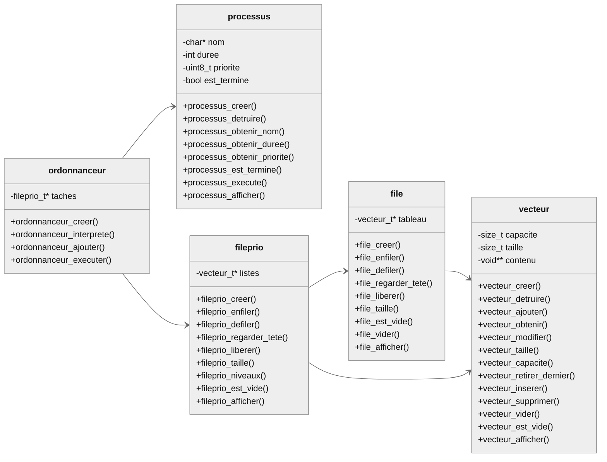

Cours 05
Programmation haut-niveau 

Implémentation d'une File Prioritaire avec Vecteur
Étude de cas : simulation d'ordonnanceur

Algorithme Round-Robin avec priorités
Système d'exploitation 

Notion de processus
Rôle et fonctionnement de l'ordonnanceur
Notion d'appel au système
(commun, ordonnanceur-v1 et ordonnanceur-v2)

=====================================================================

Méthode de déverminage
    Obtenir un mode de défaillance (symptôme).
    Émettre une hypothèse sur les causes du défaut.
    Concevoir un test minimal permettant de vérifier l'hypothèse.
    Exécuter le test et noter le résultat.
    Placer un breakpoint à l'endroit stratégique et comparer valeur attendue/obtenue.
    Corriger le défaut et exécuter à nouveau la suite de test pour trouver le prochain ;-)
    (ordonnanceur-v3)

===============================================================================

Importance de la suite de test

Il peut être très difficile d'émettre une hypothèse utile ou de concevoir un test si on semble être en présence de plusieurs défauts, surtout si la base de code est étendue.

La présence d'une suite de tests unitaires complète permet de réduire le domaine de recherche des erreurs.

Elle permet aussi de vérifier que la résolution d'un problème n'est pas la cause d'un autre (test de régression).

(ordonnanceur-v4)

==============================================================================

============================

Exercices cours 5

Problème 1

Ajoutez une suite de tests Unity pour chacuns des modules du scheduler_v3 ou v4, à votre choix.